---

I'm **Prince Effiong** (`@codes001`) — software developer and product designer at **TIIDELAB**.

I care about how products feel, not just how they function: clean interfaces, considered motion, and code that ships.

> Frontend web developer. The future is now.

| | |
|---|---|
| **Building with** | React, Next.js, Vue, Node — plus Figma, Illustrator, Photoshop |
| **Based in** | Abuja, Nigeria |
| **Open to** | conversations, collaborations, and product work |
| **Mail** | [princeeffiong010@gmail.com](mailto:princeeffiong010@gmail.com) |

---

**Connect**

---

**Stack**

**Frontend**  

**Backend and data**  

**Design and tools**  

---

**GitHub**

---

*Thanks for dropping by. Let's build the future.*

Prince Effiong · Software Developer · Product Designer
